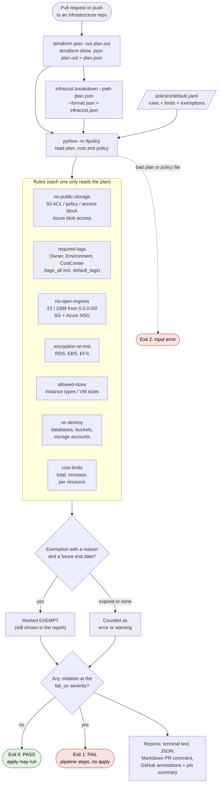

# Problem #8

**Write a Python tool that validates Terraform plans against a policy-as-code ruleset (e.g., no public
S3 buckets, required tags, cost thresholds) and fails the pipeline if violated.**

## What it does

`tfpolicy` reads the plan that Terraform is about to apply (`terraform show -json`), plus an optional
Infracost cost estimate. It checks both against the rules in `policies/default.yaml` and exits with
**1 if a rule is broken**, which stops the pipeline before `terraform apply`.

| Rule | Checks (AWS and Azure) |
|---|---|
| `no-public-storage` | S3 public ACLs, bucket policies open to `"*"`, a missing or weakened public access block; Azure anonymous blob access and public containers |
| `required-tags` | `Owner`, `Environment` (allowed values), `CostCenter` (pattern). Uses `tags_all`, so provider `default_tags` count |
| `no-open-ingress` | SSH/RDP (or any ports you list) open to `0.0.0.0/0`, `::/0` or `Internet`, in security groups, SG rules and Azure NSGs |
| `encryption-at-rest` | RDS instances/clusters, EBS volumes, EFS file systems |
| `allowed-sizes` | Instance types and VM sizes against an allow list (wildcards allowed) |
| `no-destroy` | Databases, buckets, tables and storage accounts that would be **destroyed or replaced** |
| `cost-limits` | Monthly total, monthly increase and per-resource cost, from Infracost |

Nothing is hardcoded in the rules. Ports, tags, sizes, limits and severities all come from the policy
file.

## Architecture



The diagram was made with Mermaid. Its source is in `docs/policy-check.mmd`, and GitHub also draws it
from the block below. [Open it in the Mermaid editor](https://mermaid.ai/app/plugin/save?state=pako%3AeNp1VX9vGzcM_SrE5Z8E89mO3a2rMWTwkjTbkLRBXAwD6iKQ73i2Gp10k3RxrkW_-0jq4sRZ5_wAQ4mPT-Qj8zUrXInZLKuM2xYb5SN8OFtaoE_jDz8us-vWGPD4T4shgvPQtGHzy8qPTqIDZUHbyqsQfVvE1iNdbNwy-3QEeX4CjVGWECJ6ryrna3FA7too1pCMhLS7EDZuC_nn4OzuBiScITsJuacmQJSicCFSCmHBNqw8qrvSbfm4UXHzFCyp8pzzqAiS4wR2gf-Db5wqk0vQ912NM7roPo6WmVgaw6jESrUmDjtVG0noW4MBfgCjax3ZwAesm6idDcts9OkFIlv0nKaLG6KX1xCrlCRhoSqF2iCxUbbsORBxQZJsS5vAQrtae9Vskpdgb4TLIapiA84i_ZgOGDRA3KAgH-1KwJ9SeyyYK1zePHn9MWFZlzftinLnITqv1igMF1OYn17CqKdFhioKDAFWxhV3cmX-hXVCf6_6s72MfkLYrDbKXOZRrYMEvd9a9AM4t_faO1ujjQM4pRKckoVerhzy5VtFYtW2MEPoO3HL7v1X-Wni7xq0ubZrTyQEYjIhwtPpz2-g8q6G8VC-RuP0tAtqXiL_bnGxD_iKANEWvpPG5irmhJm0fXO2IN6_8a-3i_2oHymK-LotvTToL5hIaBuisgVC7Brq1gj-ugI53Q_-Kb2hpDzeJXmUKqqVChgGsGqLO4xhIP6-QVxu19r4Aug1AbGa8qTQfrSjMgMuJKkjYIJp0JNYgmt9gTsItOWj3JLSWYVJ4l-X2fmj1mGraRQVi-1xElm8CqpW1gbBANHHX5fZtx5YQgkOllnHjxfkWvk75Am5EgPO_z6_uv6Q-h-ipubzBuGtJIrmbeTjU_efg-JDwxrjlWZpGPoEUiHJcJosUKkktKLoJn1vlbckmh1moiTB9-hLXcTHfZHinx1QRea2g3vtjJKq0B4imoJfKW1uyRWQLuvYPVWiD2bW1qW9qkLg1Xz-oCOMZ3A9XyxSTZuGJrpWNNUtL7Oj_yB0fYs43Q7ieAZv539cpi7rBo2m5UCqaUhJlFJQn9B4R0E-pBKu-nUk_xbSwFfacCmHrALvdxkmM2pJQ8tcyvg9Zid9s3hNiRFmQKNda6sMGQ808H8u3r9LUuTuy46_vqE617IP5OBCx99bWizWkoJlydLQfqZVE9qaGtVJ1_r-GKriGVbAryDaZnZQlTjB4wFP1B3ODorx9M1kNSiccX52MB6PXwSunXuMxGn16lnkBF-X08n3I6X0A6oDJ37u564KZvbtX9cEfkk&utm_source=mermaid_app_widget&utm_medium=claude-app-v1).



## Repository layout

```
Problem #8/
├── tfpolicy/
│   ├── plan.py          reads plan JSON (and the code references, to link S3 buckets to their access blocks)
│   ├── rules.py         the 7 rules, one small function each
│   ├── engine.py        loads the policy, runs rules, applies exemptions, decides pass/fail
│   ├── report.py        text, Markdown (PR comment), JSON, GitHub annotations
│   └── cli.py           command line, exit codes
├── policies/default.yaml        the ruleset (edit this)
├── examples/
│   ├── plan-compliant.json / plan-violations.json / infracost.json   sample inputs
│   ├── sample-output.txt / sample-report.md                          what the tool prints
│   └── terraform-pipeline.yml   plan -> Infracost -> tfpolicy -> PR comment, for your infra repo
├── tests/                       63 tests
└── .github/workflows/ci.yml     tests on Python 3.10 / 3.12 / 3.14
```

## Quick start

```bash
cd "Problem #8"
python3 -m venv .venv && source .venv/bin/activate
pip install -r requirements.txt

# try it on the samples
python -m tfpolicy examples/plan-compliant.json --policy policies/default.yaml          # exit 0
python -m tfpolicy examples/plan-violations.json --policy policies/default.yaml \
  --infracost examples/infracost.json                                                   # exit 1

# on your own Terraform
terraform plan -out plan.out
terraform show -json plan.out > plan.json
infracost breakdown --path plan.json --format json --out-file infracost.json            # optional
python -m tfpolicy plan.json --policy policies/default.yaml --infracost infracost.json
```

## Example output

```
$ python -m tfpolicy examples/plan-violations.json --policy policies/default.yaml --infracost examples/infracost.json
Checked 8 resource(s) with 7 rule(s).
  [ERROR  ] no-public-storage    aws_s3_bucket_acl.public_site: bucket ACL is 'public-read' (public)
  [ERROR  ] no-public-storage    aws_s3_bucket_policy.public_site: bucket policy allows Principal "*" without a Condition
  [ERROR  ] no-public-storage    azurerm_storage_account.data: allow_nested_items_to_be_public = true (anonymous blob access)
  [ERROR  ] no-public-storage    aws_s3_bucket.public_site: S3 bucket has no aws_s3_bucket_public_access_block in this plan
  [ERROR  ] required-tags        aws_s3_bucket.public_site: tag Environment='production' is not one of ['dev', 'stage', 'prod']
  [ERROR  ] required-tags        aws_s3_bucket.public_site: missing required tag 'CostCenter'
  [ERROR  ] required-tags        azurerm_storage_account.data: missing required tag 'Environment'
  [ERROR  ] required-tags        azurerm_storage_account.data: missing required tag 'CostCenter'
  [ERROR  ] no-open-ingress      aws_security_group.admin: ingress rule opens port(s) [22] to the whole internet
  [ERROR  ] no-open-ingress      azurerm_network_security_rule.rdp: NSG rule 'allow-rdp' opens port(s) [3389] to the internet
  [ERROR  ] encryption-at-rest   aws_db_instance.reports: storage_encrypted must be true
  [WARNING] allowed-sizes        aws_db_instance.reports: instance_class 'db.r6i.4xlarge' is not in the allowed list
  [ERROR  ] no-destroy           aws_db_instance.legacy: would be destroyed; data may be lost
  [ERROR  ] cost-limits          (cost): monthly total 742.18 USD is over the limit of 500.00
  [ERROR  ] cost-limits          (cost): monthly increase 440.78 USD is over the limit of 100.00
  [ERROR  ] cost-limits          aws_db_instance.reports: costs 583.44 USD/month, over 200.00
FAIL: 15 error(s), 1 warning(s), 0 exempted (fail on: error)
exit code: 1
```

The same result as a Markdown table for a pull request comment is in `examples/sample-report.md`.

## Options

| Option | Environment variable | Default |
|---|---|---|
| `PLAN` (first argument) | `TFPOLICY_PLAN` | required |
| `--policy` | `TFPOLICY_POLICY` | `policies/default.yaml` |
| `--infracost` | `TFPOLICY_INFRACOST` | none (cost rule is skipped, with a note) |
| `--format` | `TFPOLICY_FORMAT` | `text` (`markdown`, `json`) |
| `--output` | `TFPOLICY_OUTPUT` | also write the report to a file |
| `--markdown-output` | `TFPOLICY_MARKDOWN_OUTPUT` | write a Markdown report (PR comment) |
| `--fail-on` | `TFPOLICY_FAIL_ON` | the policy's `fail_on` (`error` or `warning`) |

**Exit codes:** `0` passed, `1` policy violated (fail the pipeline), `2` bad input (unreadable plan or
policy).

Inside GitHub Actions, it also writes `::error` annotations and a job summary on its own.

## The policy file

```yaml
version: 1
fail_on: error            # fail on errors only, or "warning" to fail on warnings too
rules:
  required-tags:
    severity: error
    tags:
      Owner: {}                              # any non-empty value
      Environment: [dev, stage, prod]        # one of these
      CostCenter: {pattern: "^CC-[0-9]{4}$"} # regular expression
  cost-limits:
    max_monthly_increase: 100                # in the Infracost currency
exemptions:
  - rule: no-open-ingress
    address: module.bastion.aws_security_group.ssh   # wildcards allowed
    reason: "Bastion; source IPs limited by the NACL. Ticket SEC-123"
    expires: 2026-12-31
```

- Every rule can be turned off with `enabled: false` or made a `warning`.
- **Exemptions must have a reason and an end date.** An exempted violation is still shown, marked
  EXEMPT. After the end date the exemption stops working and the report says it **expired**. An
  exemption that matched nothing is reported too, so old ones get cleaned up.
- **By default only resources being created or changed are checked**, so a new rule does not block every
  pipeline at once because of old resources. Set `include_unchanged: true` on a rule to check
  everything in the plan.

## Using it in a pipeline

`examples/terraform-pipeline.yml` (GitHub Actions) runs these steps:
1. Logs in to AWS with OIDC (see Problem #4).
2. Runs `terraform plan`, then `terraform show -json`.
3. Runs `infracost breakdown`.
4. Runs `tfpolicy`. The job fails here on a violation, so a later apply job never runs.
5. Posts the Markdown report on the pull request.

**Azure DevOps** uses the same commands in a script step:

```yaml
- script: |
    terraform show -json plan.out > plan.json
    python -m tfpolicy plan.json --policy policies/default.yaml --infracost infracost.json
  displayName: Policy check      # a non-zero exit code fails the stage
```

## Security considerations

- The tool **only reads files**. It needs no cloud credentials and makes no network calls.
- **Plan JSON can contain secrets** (values marked sensitive are hidden, but not every secret is marked).
  Do not upload `plan.json` as a public artifact, and delete it after the job.
- **Severity and exemptions are reviewed in git.** Keep `policies/` under CODEOWNERS, so only the
  platform or security team can approve changes to the rules.
- **Unknown values are not guessed.** A value that is only known after apply, such as encryption
  computed by another resource, is skipped rather than reported falsely. Required tags still use
  `tags` when `tags_all` is unknown.

## Idempotency

The check is read-only and deterministic: the same plan, policy and date always give the same result.
Exemption dates are the only time-dependent part.

## Testing and CI

```bash
pip install -r requirements-dev.txt
ruff check . && ruff format --check .
python -m pytest            # 63 tests, under 1 second
```

- **The tests use plans in the real `terraform show -json` format**, built by `tests/helpers.py`. They
  include modules, `count` indexes, unknown values, replacements, data sources and the code
  references that link an access block to its bucket.
- **Each rule has passing and failing cases.** For example, a bucket policy with `Principal: "*"` but a
  VPC endpoint `Condition` is correctly allowed, and an egress rule open to everyone is correctly
  ignored.
- **I checked the tests by breaking the code on purpose** (ignoring policy conditions, ignoring code
  references, missing the "all protocols" rule, misreading unknown tags, checking unchanged resources,
  missing replacements, missing the Azure `Internet` tag). Every break was caught.

## Limitations

- **Terraform itself was not run here**, because its download was blocked. The sample plans follow the
  documented JSON format, but your first real `terraform show -json` is the real test. If a rule misses
  something in your plan, add that shape to `tests/helpers.py`.
- **It checks what the plan contains.** If an S3 bucket's public access block was created in an earlier
  run and is unchanged, it is still in the plan as a no-op, so it counts. A block managed in a different
  Terraform state would not be seen.
- **Cost checks need Infracost** (free API key) and use list prices, not your discounts.
- **For very large rule sets**, OPA/Conftest (Rego) or HashiCorp Sentinel are the industry tools. This
  tool is easier to read and extend in Python, and covers the common rules.

## Troubleshooting

| Message | Fix |
|---|---|
| `does not look like terraform show -json output` | Use `terraform show -json plan.out`, not `terraform plan -json` (that is a log stream) |
| `S3 bucket has no aws_s3_bucket_public_access_block` but you have one | Its `bucket` must reference that bucket (`aws_s3_bucket.x.id`) in the same configuration |
| `cost-limits skipped` | Pass `--infracost infracost.json` |
| `exemption ... EXPIRED` | Renew it with a new date and reason, or fix the resource |
| `unknown rule` | Check the spelling against the table at the top |
